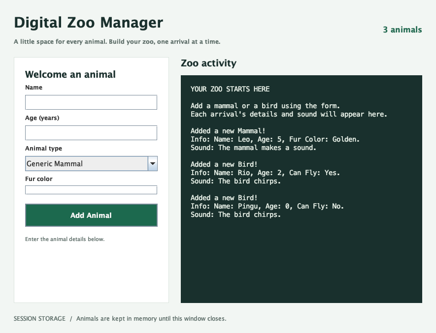

# Digital Zoo Manager

Aplikasi desktop Java Swing untuk UTS sesuai `uts.pdf`. Pengguna dapat menambahkan mamalia dan burung ke kebun binatang, lalu melihat informasi serta suara masing-masing hewan. Data disimpan di memori dan hilang saat aplikasi ditutup, sesuai ketentuan soal.



## Menjalankan aplikasi

Gunakan **JDK 8 atau lebih baru**, bukan hanya JRE. Tidak ada library eksternal yang diperlukan.

### IntelliJ IDEA

1. Pilih **File → Open**, lalu pilih folder proyek ini atau `pom.xml`.
2. Jika diminta, buka sebagai proyek Maven dan pilih JDK pada **Project SDK**.
3. Buka `src/main/java/Main.java`, lalu jalankan method `main` melalui tombol Run.

Jika JDK Homebrew di Mac ini belum terdeteksi IntelliJ, pilih **Add JDK** dan gunakan `/opt/homebrew/opt/openjdk/libexec/openjdk.jdk/Contents/Home`.

### Terminal macOS / Linux

```sh
sh run.sh
```

Script otomatis mengenali `JAVA_HOME`, instalasi Homebrew, atau `javac` di PATH. Untuk hanya membuat JAR:

```sh
sh build.sh
java -jar dist/DigitalZooManager.jar
```

JAR yang dibangun lewat `build.sh` kompatibel dengan Java 8+. Di Windows, jalankan `run.bat` dengan JDK tersedia di `JAVA_HOME` atau PATH. Alternatif jika Maven sudah terpasang: `mvn package`, lalu `java -jar target/digital-zoo-manager-1.0.0.jar`.

## Cara menggunakan

1. Isi **Name** dan **Age (years)**. Umur berupa bilangan bulat 0–2147483647.
2. Pilih **Generic Mammal** atau **Generic Bird**.
3. Untuk mamalia, isi **Fur color**. Untuk burung, centang **Can fly?** jika bisa terbang.
4. Klik **Add Animal** atau tekan Enter.
5. Informasi dan suara ditambahkan ke **Zoo activity**, jumlah hewan bertambah, dan form dikosongkan.

Nama kosong, umur tidak valid/negatif, serta warna bulu kosong akan menampilkan pesan validasi tanpa menambahkan hewan. Nama yang sama diperbolehkan karena soal tidak mewajibkan nama unik.

Contoh isi log:

```text
Added a new Mammal!
Info: Name: Leo, Age: 5, Fur Color: Golden.
Sound: The mammal makes a sound.

Added a new Bird!
Info: Name: Rio, Age: 2, Can Fly: Yes.
Sound: The bird chirps.
```

## Pemetaan ketentuan UTS

| Ketentuan | Implementasi |
| --- | --- |
| Superclass dengan field private `name`, `age`, constructor, getter/setter | `Animal.java` |
| `makeSound()` dan `getInfo()` pada superclass | `Animal.java` |
| Mamalia mewarisi `Animal`, memiliki `furColor`, memanggil `super()` | `Mammal.java` |
| Burung mewarisi `Animal`, memiliki `canFly`, memanggil `super()` | `Bird.java` |
| Override suara dan informasi pada kedua subclass | `Mammal.java`, `Bird.java` |
| Jendela `JFrame` dengan layout managers | `ZooFrame.java`: BorderLayout, GridBagLayout, CardLayout |
| Input `JTextField`, jenis `JComboBox`, atribut khusus, tombol tambah | Form pada `ZooFrame.java` |
| Log `JTextArea` non-editable | `logArea` pada `ZooFrame.java` |
| Penyimpanan `ArrayList<Animal>` di `ZooFrame` | Field `animals` |
| Buat subclass yang dipilih, simpan, panggil `getInfo()` dan `makeSound()` | Method `addAnimal()` |
| Titik masuk aplikasi di Swing event dispatch thread | `Main.java` |

`Animal animal` dapat merujuk ke objek `Mammal` atau `Bird`. Ketika `getInfo()` dan `makeSound()` dipanggil melalui referensi tersebut, Java menjalankan implementasi milik subclass. Ini menunjukkan inheritance, encapsulation, method overriding, dan polymorphism sesuai soal.

## Struktur proyek

```text
src/main/java/      Animal, Mammal, Bird, ZooFrame, Main
src/test/java/      Pengujian model dan interaksi Swing
scripts/java-env.sh Pencarian JDK untuk script terminal
pom.xml             Konfigurasi impor IntelliJ / build Maven
run.sh / run.bat    Menjalankan aplikasi
build.sh            Membuat dist/DigitalZooManager.jar
test.sh             Menjalankan pengujian tanpa dependency
uts.pdf             Soal asli
```

## Pengujian

```sh
sh test.sh
```

Pengujian memeriksa getter/setter, inheritance dan polymorphism, validasi input, penambahan mamalia/burung, pergantian atribut form, log, serta jumlah hewan. Tes GUI memerlukan desktop; pada lingkungan headless tes tersebut ditandai `SKIP`. Pratinjau hasil tes GUI disimpan di `build/gui-preview.png`. Script pengujian ini dijalankan langsung; `mvn test` tidak menjalankan test harness ini.

## Pengumpulan

ZIP proyek tersedia di `dist/DigitalZooManager-project.zip` setelah disiapkan. ZIP berisi source, konfigurasi proyek, script, soal, serta JAR siap jalan dalam `dist/`.

PDF juga meminta repository baru di GitHub dan URL repository sebagai jawaban. Repository belum dibuat atau di-push dari lingkungan ini. Setelah membuat repository kosong di akun sendiri, jalankan dari folder proyek (ganti URL sesuai repository):

```sh
git init
git add .
git commit -m "Implement Digital Zoo Manager for UTS"
git branch -M main
git remote add origin https://github.com/USERNAME/digital-zoo-manager.git
git push -u origin main
```

Folder hasil build dan konfigurasi pribadi IDE diabaikan oleh `.gitignore`. Semua source dan `pom.xml` tetap ikut di Git, sehingga proyek bisa dibuka kembali di IntelliJ. Kirim URL repository setelah push berhasil.
